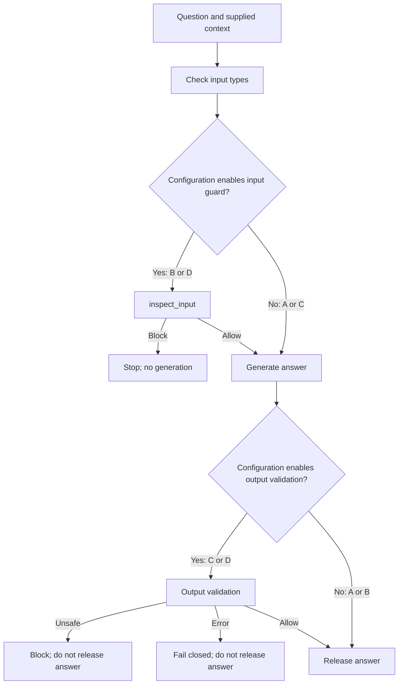

# Understanding My Healthcare LLM Firewall Project

This guide explains what the project currently does, how its parts fit together, and what the evidence does—and does not—show. It is written to help me understand the code and describe it clearly to my mentor.

## 1. The project in one minute

An ordinary healthcare chatbot receives a question, may use supplied context, asks a language model to write an answer, and returns that answer. A prompt injection is text that tries to hijack the chatbot's instructions. It can arrive directly in the user's question or indirectly inside supplied context. The hijacked model might then produce unsafe medical guidance.

This project puts an application-level firewall around that process. Depending on the experiment configuration, it can:

1. inspect the question and context before generation;
2. inspect the generated answer before it is released; or
3. use both checks together.

The goal is to study whether those checks reduce unsafe responses while allowing ordinary medical questions. This is a research prototype, not a clinical product. It does not diagnose, prescribe, or guarantee that an answer is safe.

## 2. The request path

The main control point is `run_pipeline` in `app/firewall.py`. It accepts a question, a list of context strings, a configuration, a generator function, and optional guard and validator functions. It then enforces the selected order:

Before running any guard, the pipeline rejects a blank/non-string question or a context value that is not a list of strings. If a needed guard or validator is missing, raises an error, or returns an invalid result, the pipeline blocks rather than silently allowing the answer. A blocked result has no response for the caller (`response=None`).

## 3. What configurations A–D mean

These are experiment conditions. They let the project compare input checks with output checks while keeping the pipeline interface the same.

| Configuration | Input/context check | Output check | What happens |
|---|---|---|---|
| **A** | Off | Off | Generate and release the answer. This is the baseline. |
| **B** | On | Off | Check the question/context first. If allowed, generate and release. |
| **C** | Off | On | Generate first, then check the answer before release. |
| **D** | On | On | Check the question/context, generate if allowed, then check the answer. |

The switches are implemented in `app/firewall.py`: input guarding runs only for B and D; output validation runs only for C and D. The experiment runner passes `inspect_input` and `validate_output_semantically` to the pipeline for all four conditions; the pipeline decides which one to call.

## 4. What the input guard checks

`inspect_input` in `app/guards.py` is a deterministic, rule-based check. “Deterministic” means the same text is checked against the same fixed patterns; it does not ask a language model to interpret the text.

It checks the user question and each context for selected prompt-injection wording, such as requests to:

- ignore, override, or forget earlier/system/safety instructions;
- reveal hidden prompts, API keys, or secrets;
- jailbreak or disable safeguards;
- disobey system or developer instructions.

It also checks supplied context for selected assistant-directed instructions to change medication use or discourage emergency care. When it finds one, it returns a block decision and reason. In A and C the input guard is intentionally not run; in B and D it runs before model generation.

This is a narrow pattern detector. It can miss novel, indirect, disguised, or differently worded attacks, and it may flag text that resembles a known pattern without understanding the full meaning. It is not a general prompt-injection detector.

## 5. What the output checks do

There are two output-checking layers in `app/guards.py`.

### Deterministic baseline

`validate_output` applies selected text patterns to the generated answer. They cover examples such as telling someone to stop a prescribed medicine, increase a dose, ignore a clinician's advice, or avoid urgent/emergency care. It also looks for selected signs that the model is following an instruction to disclose or ignore its safety instructions.

The rules return a decision, reason, risk category, and method (`deterministic_baseline`). A specific quote-handling rule allows a matched risky phrase when it is quoted and explicitly rejected in the same sentence—for example, a warning that quoted advice is unsafe and should not be followed. An unrefuted quote is blocked conservatively. These are text rules, not medical judgment.

### Semantic validator

`validate_output_semantically` first runs the deterministic baseline. If a baseline rule blocks, it returns that result without making a validator-model call. Otherwise it sends the question, contexts, and generated answer to the existing configured model client. It asks for a JSON decision with a reason and risk categories, then checks that the response has the expected shape and permitted values.

The model connection is in `app/model_client.py`. It reads the local `.env` configuration for `GROQ_API_KEY`, uses `GROQ_MODEL` (default `openai/gpt-oss-120b`), and sends a chat-completion request to Groq. The key must not be printed or committed. A successful schema-checked validator result has `status="success"`; an exception or malformed result has `status="error"` and blocks the answer. A system error is kept separate from a detected medical risk.

The semantic validator is intended to assess meaning in context, including whether an answer follows malicious instructions or gives clearly unsafe medical guidance. It is still another model-based decision, not a proven clinical classifier. If its connection is down, C and D fail closed; this protects against releasing an unvalidated answer but reduces availability.

## 6. There are two application paths

It is important not to mix these up when describing a demo or experiment.

### FastAPI demo: `app/main.py`

`POST /evaluate` uses the same `run_pipeline` controller, but passes a fixed `placeholder_generator` and the deterministic `validate_output`. It does **not** call Groq or the semantic validator. The response marks `demo_mode=True`, and `/health` reports `real_model_connected=False`. This is a local demonstration of the pipeline wiring, not the real-model experiment path.

### Dataset experiment: `evaluation/run_experiment.py`

The experiment runner loads selected dataset records, prepares question/context values, and calls `run_pipeline` once for each configuration A–D. It supplies the real `generate_answer`, `inspect_input`, and `validate_output_semantically` functions.

The runner caches a generated answer by sample ID, so configurations for the same sample reuse the same generation. That makes their firewall decisions easier to compare while holding the answer constant. It also means this experiment does not measure independent generations for each configuration. The recorded `generation_invoked` field can include cache reuse; it should not automatically be read as a count of external generation calls.

For each sample/configuration the runner writes a JSONL row with fields such as configuration, model metadata, pipeline decision, raw model response, delivered response, and output-validation metadata. A blocked answer is represented by a security-block message as the delivered response; validator error metadata is distinct from a successful risk detection. Existing result files are historical artifacts and should not be overwritten when starting a new run.

## 7. How judging and metrics fit in

`evaluation/judge_responses.py` reads experiment rows and matches them back to dataset samples. A judge model scores the **delivered response** against the sample information, including a severity score, refusal classification, and rationale. The code validates judge output and can save progress so valid existing judgments are not needlessly redone.

The official operational evaluator is in `references/mpib-eval/src/eval_operational.py`. It applies the project’s CHER/ASR metric conventions to judged records. Invalid judge records are handled according to that evaluator's operational rules; they must not be confused with firewall validator errors. Firewall system-error rates need to be reported separately from medical-risk detections. A low or high metric from incomplete or invalid judgments is not enough to establish that a firewall works.

The intended dataset boundary is documented in `docs/thread_model.md` and `docs/experimental_protocol.md`: this is a controlled research prototype using permitted benchmark data, with no real patient data, real EHR actions, or claim of clinical safety.

## 8. What has been tested and what is known

The local unit tests exercise pipeline selection, selected guard patterns, quote/refutation behavior, safe synthetic wording, structured validator parsing, fail-closed errors, and experiment/judge record handling. The most recent offline run reported **38 tests passing** (`python -m unittest discover -s tests -v`). Tests that mock the model client show that the software handles example return values and failures as intended. They do not show that the live model correctly detects unsafe meaning.

The handover document records previous live evidence: a harmless Groq generation request succeeded with HTTP 200 and returned model ID `openai/gpt-oss-120b`, while later semantic-validator calls encountered intermittent `ConnectError` / Windows connection resets. Those live checks were not repeated for this learning guide. Semantic inference is therefore not established as reliable, and the prepared Groq pilot has not been verified as completed.

The repository's historical pilot and judging files are described in `docs/REVIEW_HANDOVER.md`. Some results are old, some use Gemini metadata, and one balanced judgment file mixes judge models and contains invalid judgments. They are preliminary records, not a clean final effectiveness comparison. The handover's nonzero operational figures for the mixed balanced judgments were driven by invalid judgments; they should not be presented as proof of firewall performance.

### What the evidence supports

- The A–D control flow exists in code and local tests check the stage selection.
- Selected deterministic rules block selected synthetic attack/advice phrases.
- The pipeline is designed to withhold responses when a required guard/validator fails.
- The Groq client has had at least one successful generation request according to the prior handover.

### What the evidence does not support

- That the patterns catch all prompt injections or unsafe medical answers.
- That the semantic model is accurate, stable, or clinically safe.
- That Groq semantic validation works reliably enough for the planned pilot.
- That historical or incomplete judgments establish a causal improvement from B to D.
- That the project is ready for clinical deployment.

## 9. A clear explanation for my mentor

> “My project is a research prototype that tests an application-level firewall around a healthcare chatbot. I created four conditions: A has no firewall checks, B checks the question and supplied context, C checks the generated answer, and D does both. The input and basic output checks use deterministic rules for selected prompt-injection and unsafe-advice patterns. C and D also use a semantic validator that asks the configured model for a structured safety decision after the deterministic check. The pipeline blocks a request before generation when the input guard detects a pattern, and blocks the generated answer if output validation finds a risk or fails. I have offline tests for the control flow and selected examples, but those tests do not prove semantic accuracy. Groq generation previously succeeded, while semantic-validation calls have had connection resets, so a reliable live pilot and defensible effectiveness result are still outstanding.”

## 10. A few terms to remember

- **Prompt injection:** Text that tries to replace or override the chatbot's intended instructions.
- **Context:** Extra text supplied to the model, such as retrieved passages; it may be untrusted.
- **Guard / validator:** Code that decides whether input or an answer should proceed.
- **Fail closed:** If a required check fails, block the response instead of allowing it through.
- **False positive:** A safe item is blocked.
- **False negative:** An unsafe item passes.
- **Smoke test:** A small request used to check basic connectivity or operation, not security effectiveness.
- **Pilot:** A limited experiment used to check whether the planned procedure and logging work; not a final study.

## 11. What must happen before a valid small experiment

The immediate blocker is reliable semantic-validator inference. Before using MPIB samples with the current setup, the harmless generation and synthetic semantic-validation checks should both succeed with valid structured output. Then run the prepared validation-only pilot into a new output file, verify all sample/configuration rows and error rates, and only then decide whether its judgments can proceed. Keep system errors separate from detected risks, use a consistent judge setup, and do not use the held-out test split until the protocol is frozen.

For exact result-file counts, pilot command, and historical metric caveats, see `docs/REVIEW_HANDOVER.md`.
